# SimSiPM


<p align="center">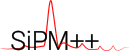</p>

[](https://github.com/EdoPro98/SimSiPM/actions/workflows/cmake-multi-platform.yml)


[](https://github.com/EdoPro98/SimSiPM/blob/master/LICENSE)

[](https://pepy.tech/project/sipm)
[](https://pepy.tech/project/sipm)

**A fast, dependency-free C++ library (with Python bindings) to simulate Silicon Photomultipliers: from photons to waveforms, including noise, crosstalk, afterpulses and saturation.**

<p align="center">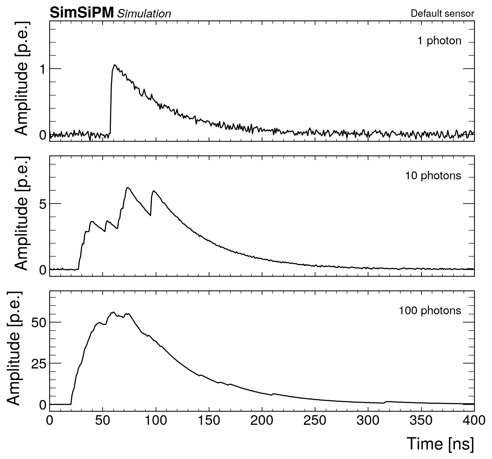</p>
<p align="center"><sub>The same sensor simulated with 1, 10 and 100 photons (scintillation-like arrival times). Each event takes a few microseconds.</sub></p>

## Authors
SimSiPM has been developed by Edoardo Proserpio under the supervision of professor Romualdo Santoro at University of Insubria Como - Italy.
SimSiPM is distributed as an Open Source project and if you plan to use it please acknowledge us as authors or [cite](#cite) us in your paper.

## Table of contents
1. [Introduction](#introduction)
2. [Features](#features)
3. [How the simulation works](#how-the-simulation-works)
4. [Installation](#installation)
5. [Quick start](#quick-start)
6. [User guide](#user-guide)
7. [Physics models](#physics-models)
8. [Results](#results)
9. [Performance](#performance)
10. [Examples, tests and documentation](#examples-tests-and-documentation)
11. [Contributing](#contributing)
12. [Cite](#cite)
13. [Contacts](#contacts)

## Introduction
SimSiPM is a simple and easy to use C++ library providing a set of object-oriented tools with all the functionality needed to describe and simulate Silicon PhotonMultipliers (SiPM) sensors.
The main goal of SimSiPM is to include the response of SiPM sensors, along with noise and saturation effects, in the description of a generic detector in order to have a more detailed simulation. It can also be used to perform optimization studies considering different SiPM models, allowing to choose the most suitable product available on the market.

SimSiPM has been developed especially for high-energy physics applications and particle physics experiments, however its flexibility allows to simulate any kind of experiment involving SiPM devices.

SimSiPM does not have any external runtime dependency, which makes it the perfect candidate to be used in an already existing environment (Geant4 or DD4HEP) or as "stand-alone".

## Features
- **Easy to use**
  - Straightforward installation without external dependencies (C++17 and CMake)
  - Object oriented API where a `std::vector` of photon times is all the input you need
  - Python bindings via Pybind11, with zero-copy [NumPy](https://numpy.org) access to the waveforms
  - Interactive real-time simulator in [`examples/gui`](examples/gui)
- **Describes a real SiPM**
  - Parameters that come from the datasheet or from laboratory measurements: size, cell pitch, DCR, crosstalk, afterpulses, PDE, cell recovery time, pulse shape, SNR
  - Dark counts, optical crosstalk (also delayed), fast and slow afterpulses, cell-to-cell gain variation and saturation, all with their correlations: every hit knows which hit generated it
  - Flat or wavelength-dependent photon detection efficiency, and three hit distributions on the sensor surface (uniform, circular, gaussian)
  - Analytic pulse shape with optional slow component, or your own measured pulse shape
  - No electronic circuit simulation
- **Flexible output**
  - Complete list of hits with time, cell, amplitude, type and parent, plus Monte Carlo truth counters
  - Waveform and feature extraction: integral, peak, time of arrival, time over threshold, time of peak
  - **Hit-only mode**: skip the waveform when you only need the hits, the signal is generated on demand
- **High performance**
  - A typical 25-photon event takes about 2 µs, a 1000-photon event about 30 µs ([benchmarks](#performance))
  - Vectorized random number generation (AVX2 / AVX-512) and signal generation, low memory footprint
- **Reliable**
  - Unit tests in C++ (GoogleTest) and Python (pytest) and complete [Doxygen](#examples-tests-and-documentation) documentation

## How the simulation works
Everything starts from the arrival times of the photons on the sensor. The simulation is done in two stages that can be run together or separately: first the **hits** (which cells fire, when and how strongly), then the **signal** (the waveform made by those hits).

<p align="center">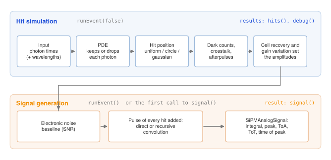</p>

Every fired cell is a *hit*. Besides the photoelectrons that come from photons, hits can be produced by the sensor itself. The figure shows one simulated event: every hit can in turn generate new hits (arrows, from parent to child), so a photoelectron can start a chain such as crosstalk, afterpulse, afterpulse, while dark counts start chains of their own:

<p align="center">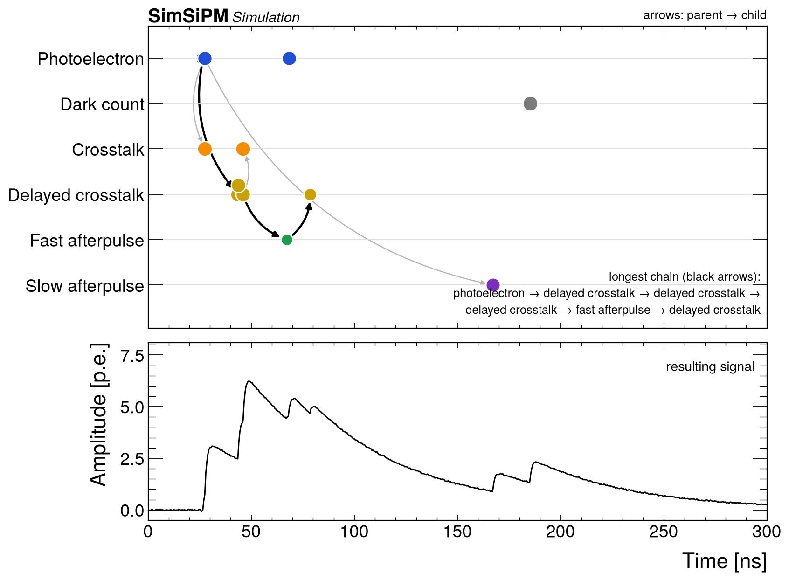</p>

| Hit type | Origin |
|---|---|
| Photoelectron | A photon that passed the PDE selection |
| Dark count | Thermal generation, a Poisson process with rate DCR over the whole sensor |
| Crosstalk | A secondary photon from an avalanche fires one of the 8 neighbouring cells at the same time |
| Delayed crosstalk | Same, but the secondary photon is absorbed later (exponential delay) |
| Afterpulse | A trapped carrier is released and fires the **same** cell again, after a fast or a slow exponential delay |

Crosstalk and afterpulses are generated by *every* hit, including the ones they created, so they form chains. Each hit stores the index of its parent hit (`-1` for photoelectrons and dark counts).

The amplitude of a hit is then set by the state of its cell. A cell that has just fired needs time to recharge, so a second hit in the same cell gives a smaller pulse. This is what produces **saturation** with many photons:

<p align="center">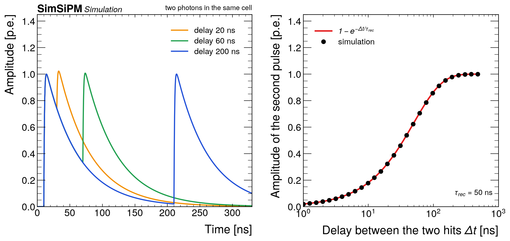</p>

$$A = 1 - e^{-\Delta t / \tau_{rec}}$$

where $\Delta t$ is the time since the previous hit in that cell. A random cell-to-cell gain variation (CCGV) is also applied to each amplitude.

In the second stage every hit becomes a pulse and the pulses are summed on top of the electronic noise. The pulse of one photoelectron is the difference of exponentials below, normalised so that its peak is **1** (all amplitudes in SimSiPM are in units of photoelectrons, p.e.):

$$g(t) \propto (1-f)\,e^{-t/\tau_f} + f\,e^{-t/\tau_s} - e^{-t/\tau_r}$$

<p align="center">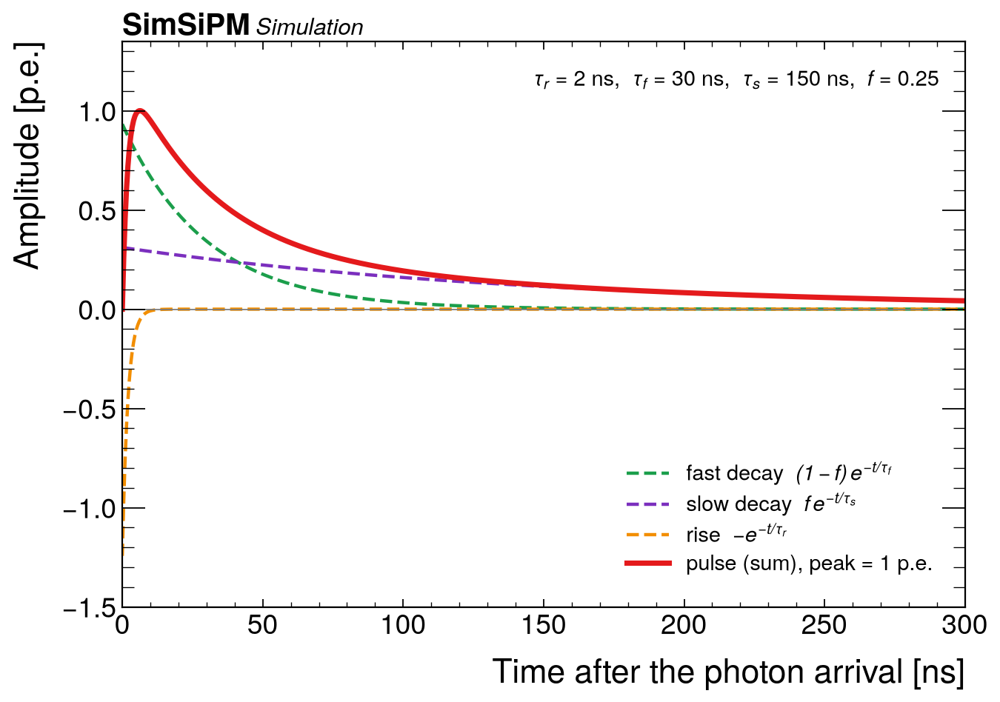</p>

## Installation
SimSiPM is fully functional without any external dependencies other than a C++17 compiler and CMake.
#### Optional dependencies
- Pybind11: to generate Python bindings
- Google Benchmark: to run the benchmarks
- GTest / Pytest: to run the tests
- Doxygen (and Graphviz): to generate the documentation

### C++
SimSiPM can be installed using the standard CMake workflow:
```sh
# In SimSiPM directory
cmake -B build -S .
cmake --build build -j
cmake --install build            # installation directory: -DCMAKE_INSTALL_PREFIX=<dir>
```

| CMake option | Default | Effect |
|---|---|---|
| `SIPM_BUILD_PYTHON` | OFF | Build the Python module `SiPM` (needs Pybind11) |
| `SIPM_ENABLE_TEST` | OFF | Build the unit tests in `build/tests` |
| `SIPM_ENABLE_BENCH` | OFF | Build the benchmarks in `build/bench` |
| `SIPM_BUILD_DOCS` | OFF | Generate the Doxygen documentation |
| `SIPM_BUILD_GUI` | OFF | Build the interactive simulator (fetches GLFW, Dear ImGui, ImPlot) |

The default build type is `Release` and the compiler flags include `-ffast-math`. Compiler optimizations matter: adding `-march=native` enables the AVX2 / AVX-512 implementations of the random number generator and vectorized loops (see [Performance](#performance)). Note that setting `CMAKE_CXX_FLAGS` replaces the default flags, so keep `-ffast-math`:
```sh
cmake -B build -S . -DCMAKE_CXX_FLAGS="-ffast-math -march=native"
```

To use the installed library from another CMake project:
```cmake
find_package(sipm REQUIRED)
target_link_libraries(myapp PRIVATE sipm::sipm)
```
and in the code `#include <SiPM.h>`.

### Python
The easiest way to use SimSiPM from Python is the precompiled wheel:
```sh
pip install SiPM
```
It can also be built from the sources with `pip install .` or by adding `-DSIPM_BUILD_PYTHON=ON` to the CMake workflow above. Each class is available in the `SiPM` module:
```python
import SiPM
print(SiPM.__version__)
```

## Quick start
This is a complete program: a sensor, 25 photons from a scintillator-like emission (exponential decay with a time constant of 40 ns, starting at 20 ns) and the features of the resulting signal.

<!-- program -->
```cpp
#include <SiPM.h>
#include <iostream>
using namespace sipm;

int main() {
  SiPMProperties props;            // default sensor: 1x1 mm2, 25 um cells
  props.setDcr(250e3);             // dark count rate in Hz

  SiPMSensor sensor(props);
  SiPMRandom rng;

  std::vector<double> times = rng.randExponential(40.0, 25);
  for (double& t : times) t += 20.0;

  sensor.addPhotons(times);        // arrival times in ns
  sensor.runEvent();               // simulate the event

  SiPMAnalogSignal signal = sensor.signal();
  std::cout << "integral: " << signal.integral(10, 300, 0.5) << "\n";
  std::cout << "peak:     " << signal.peak(10, 300, 0.5) << "\n";
}
```

The same in Python:
<!-- python -->
```python
import numpy as np
import SiPM

props = SiPM.SiPMProperties()
props.setDcr(250e3)

sensor = SiPM.SiPMSensor(props)
rng = SiPM.SiPMRandom()

times = 20.0 + np.asarray(rng.randExponential(40.0, 25))
sensor.addPhotons(times)
sensor.runEvent()

signal = sensor.signal()
print("integral:", signal.integral(10, 300, 0.5))
print("peak:    ", signal.peak(10, 300, 0.5))
```
The numbers change from event to event; for these 25 photons the integral is about 1300 (25 photoelectrons, each with an integral of about 50 ns) and the peak about 12.

## User guide
SimSiPM focuses on simplicity! It does not make use of pointers or custom classes as input of the simulation. In most cases a `std::vector` is all that you need. The following sections follow one C++ session, so each block continues the previous one (the same code is available in Python with the same method names).

### SiPMProperties
`SiPMProperties` stores all the parameters of the sensor and of the simulation. It defines the SiPM model in use and it can be shared among many sensors. Parameters can be set with a typed setter or by name:
<!-- cpp -->
```cpp
#include <SiPM.h>
#include <iostream>
using namespace sipm;

SiPMProperties props;                 // default sensor
props.setDcr(250e3);                  // typed setter: dark count rate in Hz
props.setProperty("Xt", 0.03);        // or by name (case-insensitive)
std::cout << props << "\n";           // every class can be printed
```
<!-- output -->
```text
===> SiPM Properties <===
Address: 0x7ffc3fbd3a58
Size: 1.00 mm
Pitch: 25.00 um
Number of cells: 1600
Hit distribution: Uniform
Cell recovery time: 50.00 ns
Dark count rate: 250.00 kHz
Optical crosstalk probability: 3.00 %
Delayed optical crosstalk is OFF
Afterpulse probability: 3.00 %
Tau afterpulses (fast): 10.00 ns
Tau afterpulses (slow): 80.00 ns
Cell-to-cell gain variation: 5.00 %
SNR: 30.00 dB
Photon detection efficiency is OFF (100 %)
Rising time of signal: 1.00 ns
Falling time of signal (fast): 50.00 ns
Signal length: 500.00 ns
Sampling time: 1.00 ns
```

| Parameter | Setter | Name for `setProperty` | Default |
|---|---|---|---|
| Sensor size [mm] | `setSize` | `Size` | 1 |
| Cell pitch [µm] | `setPitch` | `Pitch` | 25 |
| Signal length [ns] | `setSignalLength` | `SignalLength` | 500 |
| Sampling time [ns] | `setSampling` | `Sampling` | 1 |
| Rise time constant [ns] | `setRiseTime` | `RiseTime` | 1 |
| Fast fall time constant [ns] | `setFallTimeFast` | `FallTimeFast` | 50 |
| Slow fall time constant [ns] (switches the slow component on) | `setFallTimeSlow` | `FallTimeSlow` | 100 (off) |
| Weight of the slow component | `setSlowComponentFraction` | `SlowComponentFraction` | 0.2 |
| Cell recovery time [ns] | `setRecoveryTime` | `RecoveryTime` | 50 |
| Dark count rate [Hz] | `setDcr` | `Dcr` | 200e3 |
| Crosstalk probability | `setXt` | `Xt` | 0.05 |
| Fraction of delayed crosstalk (switches it on) | `setDXt` | `DXt` | 0.05 (off) |
| Delayed crosstalk time constant [ns] | `setDXtTau` | | 15 |
| Afterpulse probability | `setAp` | `Ap` | 0.03 |
| Fast / slow afterpulse time constant [ns] | `setTauApFastComponent` / `setTauApSlowComponent` | `TauApFast` / `TauApSlow` | 10 / 80 |
| Fraction of slow afterpulses | `setApSlowFraction` | | 0.5 |
| Cell-to-cell gain variation (relative) | `setCcgv` | `Ccgv` | 0.05 |
| Signal to noise ratio [dB] | `setSnr` | `Snr` | 30 |
| Photon detection efficiency | `setPde`, `setPdeType`, `setPdeSpectrum` | `Pde` | off |
| Hit distribution | `setHitDistribution` | | uniform |

Each noise source can be switched on and off with `setDcrOff()` / `setDcrOn()`, `setXtOff()`, `setDXtOff()`, `setApOff()`, `setSlowComponentOff()`, and so on. Switching everything off gives a clean, noise-free pulse.

Properties can also be read from a JSON file or from a simple `key = value` file:
<!-- file: sensor.json -->
```json
{
  "size": 3,
  "pitch": 50,
  "dcr": 120000,
  "xt": 0.08,
  "pdeType": "kSimplePde",
  "pde": 0.4,
  "hitDistribution": "kGaussian",
  "signalLength": 400
}
```
<!-- file: sensor.conf -->
```text
# lines starting with # or / are comments
Size  = 3
Pitch = 50
Dcr   = 120e3
```
<!-- cpp -->
```cpp
SiPMProperties fromJson = SiPMProperties::readSettingsJson("sensor.json");
SiPMProperties fromConf = SiPMProperties::readSettings("sensor.conf");
std::cout << fromJson.nCells() << " cells, DCR " << fromJson.dcr() / 1e3 << " kHz\n";
```
<!-- output -->
```text
3600 cells, DCR 120 kHz
```
The JSON file accepts all the parameters of the table above (`size`, `pitch`, `signalLength`, `risingTime`, `fallingTimeFast`, `dxtTau`, `apSlowFraction`, ...), the switches `hasDcr`, `hasXt`, `hasDXt`, `hasAp` and `hasSlowComponent`, `pdeType` and `hitDistribution` (by enumerator name), and `pdeSpectrum` as `{"wavelengths": [...], "pde": [...]}`. Missing keys keep their default value. The complete list is in the documentation of `readSettingsJson`.

### SiPMSensor
`SiPMSensor` is the core of the simulation. It is created from a `SiPMProperties`, it stores the input photons, it runs the event simulation and it gives the hits and the signal as output.
<!-- cpp -->
```cpp
SiPMSensor sensor(props);
sensor.setProperty("Ap", 0.01);         // change a parameter of an existing sensor
sensor.rng().seed(42);                  // optional: reproducible simulations
```
> [!NOTE]
> The pulse shape is computed when the properties are set, so parameters that change it (`RiseTime`, `FallTimeFast`, `FallTimeSlow`, `SlowComponentFraction`, `Sampling`, `SignalLength`) must be changed through the sensor with `setProperty` or `setProperties`. `sensor.properties()` is a read-only reference in C++. In Python it is a live reference: it is fine for the noise parameters (`Dcr`, `Xt`, `Ap`, `Pde`, ...), but changes to the pulse shape parameters made through it are not applied until `setProperty` / `setProperties` is called.

### Input and simulation
The only input needed for the simulation of a SiPM event is the arrival time of each photon on the sensitive surface (in ns, from the start of the signal window). Photons outside the window are ignored. Photons can be added one by one or all at once, and they **accumulate** until `resetState()` is called:
<!-- cpp -->
```cpp
SiPMRandom rng;                                              // the library random generator
std::vector<double> times = rng.randExponential(40.0, 25);   // 25 photons, 40 ns decay time
for (double& t : times) t += 20.0;                           // starting at 20 ns

sensor.resetState();               // forget the previous event
sensor.addPhotons(times);          // all at once ...
sensor.runEvent();                 // simulate the event (hits and signal)

sensor.resetState();
for (double t : times) {
  sensor.addPhoton(t);             // ... or one at a time
}
sensor.runEvent();
```
For a wavelength-dependent PDE the wavelength of each photon is needed too: `addPhoton(time, wavelength)` and `addPhotons(times, wavelengths)`, see [Spectral PDE](#spectral-pde).

### Hits and Monte Carlo truth
After `runEvent()` the sensor gives the complete list of hits. Each hit has a time, a cell (row and column), an amplitude, a type, and the index of its parent:
<!-- cpp -->
```cpp
for (const SiPMHit& hit : sensor.hits()) {
  if (hit.parentIdx() >= 0) {                      // -1: photoelectron or dark count
    const SiPMHit& parent = sensor.hits()[hit.parentIdx()];
    std::cout << "hit at " << hit.time() << " ns (cell " << hit.row() << "," << hit.col()
              << ") was generated by the hit at " << parent.time() << " ns\n";
  }
}
```
`hit.hitType()` is one of `SiPMHit::HitType::kPhotoelectron`, `kDarkCount`, `kOpticalCrosstalk`, `kDelayedOpticalCrosstalk`, `kFastAfterPulse` and `kSlowAfterPulse`. The reference returned by `hits()` stays valid until the next `resetState()` or `runEvent()`.

`debug()` gives the Monte Carlo truth counters of the event:
<!-- cpp -->
```cpp
SiPMDebugInfo info = sensor.debug();
std::cout << info.nPhotons << " photons -> " << info.nPhotoelectrons << " hit cells ("
          << info.nDcr << " dark counts, " << info.nXt << " crosstalk, " << info.nAp << " afterpulses)\n";
```

### Signal and features
The signal is a `SiPMAnalogSignal`, a waveform with its sampling time and some methods to extract features. All the features work on an integration gate, given as the start time and the length of the gate in ns, and on a threshold. They return `-1` if the signal never exceeds the threshold in the gate.

| Method | Returns |
|---|---|
| `integral(start, gate, threshold)` | Sum of the samples times the sampling time |
| `peak(start, gate, threshold)` | Amplitude of the highest sample |
| `toa(start, gate, threshold)` | Time of the first sample above the threshold, relative to the start of the gate |
| `tot(start, gate, threshold)` | Time spent above the threshold |
| `top(start, gate, threshold)` | Time of the peak, relative to the start of the gate |

<!-- cpp -->
```cpp
SiPMAnalogSignal signal = sensor.signal();
double integral = signal.integral(10, 300, 0.5);   // (start [ns], gate [ns], threshold)
double peak     = signal.peak(10, 300, 0.5);
double toa      = signal.toa(10, 300, 0.5);
double tot      = signal.tot(10, 300, 0.5);
double top      = signal.top(10, 300, 0.5);
std::cout << "integral " << integral << ", peak " << peak << ", ToA " << toa << " ns, ToT " << tot
          << " ns, time of peak " << top << " ns\n";

// the waveform can be accessed sample by sample
double area = 0;
for (uint32_t i = 0; i < signal.size(); ++i) {
  area += signal[i] * signal.sampling();            // or: const std::vector<float>& w = signal.waveform();
}
std::cout << signal.length() << " ns long, area " << area << "\n";
```
In Python `np.asarray(signal.waveform())` gives a NumPy view of the samples without copying them.

### Hits only: skip the signal generation
Generating the waveform is the most expensive part of an event. If you only need the hits (for example to count the cells that fired, or because you build the waveform yourself) call `runEvent(false)`: only the hits are simulated.
<!-- cpp -->
```cpp
sensor.resetState();
sensor.addPhotons(times);
sensor.runEvent(false);                     // hits only: no waveform is generated
std::cout << sensor.hits().size() << " hits\n";

SiPMAnalogSignal late = sensor.signal();    // the signal is generated now, from the same hits
```
The simulation API does not change: any method that needs the signal (`signal()`) generates it the first time it is called. With the same seed, `runEvent(false)` followed by `signal()` gives exactly the same hits and waveform as `runEvent()`. Skipping the signal makes an event up to 17 times faster (see [Performance](#performance)).

> [!NOTE]
> `signal()` may generate the waveform, so it modifies the sensor. Do not call it concurrently on the same sensor. In multi-threaded applications use one `SiPMSensor` per thread.

### Custom pulse shape
The pulse shape of one photoelectron can be replaced with a measured one using `setSignalShape(shape, sampling)`. The shape is used as it is (it is not normalised, so scale it to your gain) and it defines the length of the signal:
<!-- cpp -->
```cpp
SiPMSensor custom(props);
std::vector<float> shape(200);                         // 100 ns sampled every 0.5 ns
for (int i = 0; i < 200; ++i) {
  shape[i] = (i < 10) ? i / 10.0f : std::exp(-(i - 10) / 40.0f);   // linear rise, exponential decay
}
custom.setSignalShape(shape, 0.5);                     // samples, sampling time in ns
custom.addPhoton(20.0);
custom.runEvent();
std::cout << custom.signal().size() << " samples, sampling " << custom.signal().sampling() << " ns\n";
```
Calling `setProperty` or `setProperties` with a rise or fall time goes back to the analytic shape.

### Complete event loop
This is an example of "stand-alone" usage of SimSiPM. When SimSiPM is used in Geant4 or in another framework, the generation of the photon times is done by the user (usually in `G4UserSteppingAction`) and the event is simulated after all the photons have been added (usually in `G4UserEventAction`).
<!-- cpp -->
```cpp
const int nEvents = 1000;
std::vector<double> integrals(nEvents);

for (int i = 0; i < nEvents; ++i) {
  std::vector<double> photons = rng.randExponential(40.0, 25);   // photon times of this event
  for (double& t : photons) t += 20.0;

  sensor.resetState();
  sensor.addPhotons(photons);
  sensor.runEvent();

  integrals[i] = sensor.signal().integral(10, 300, 0.5);
}
```

### Python
Python uses the same classes and method names. The main differences: `hits()` returns a list of `SiPMHit` (a copy), NumPy arrays can be used wherever a vector of numbers is expected, `signal.waveform()` is a NumPy view of the samples (no copy), and `runEvent` has a keyword argument.
<!-- python -->
```python
sensor.resetState()
sensor.addPhotons(times)                               # list or NumPy array
sensor.runEvent(generateSignal=False)                  # hits only, see above
hits = sensor.hits()
nXt = sum(h.hitType() == SiPM.SiPMHit.HitType.kOpticalCrosstalk for h in hits)
print(len(hits), "hits,", nXt, "crosstalk")

waveform = np.asarray(sensor.signal().waveform())      # the signal is generated now
print(waveform.shape, waveform.max())

props.setHitDistribution(SiPM.SiPMProperties.HitDistribution.kGaussian)   # enumerations are nested classes
sensor.setProperties(props)

sensor.setSignalShape(np.exp(-np.arange(200) / 40.0), 0.5)   # custom pulse shape, 0.5 ns sampling
print(sensor.properties().hasCustomSignalShape())
```

## Physics models
### Photon detection efficiency
Tracking a large number of photons through a scintillator crystal or an optical fiber is a very CPU-intensive task. Since most of the photons are not detected because of the photon detection efficiency (PDE), it is a waste of time to track all of them. For this reason SimSiPM can be used in three ways:

| `PdeType` | What happens to the photons you add |
|---|---|
| `kNoPde` (default) | All of them become photoelectrons. Apply the PDE yourself **before** tracking the photons, so that only the detected ones are generated and tracked |
| `kSimplePde` | Each photon is detected with the same probability `setPde(value)` |
| `kSpectrumPde` | Each photon is detected with the probability given by its wavelength |

For example the geometry of the IDEA dual-readout calorimeter requires the simulation of 130 millions of optical fibers and in each one of them photons are tracked by Geant4 requiring a lot of CPU time. It would be meaningless to track photons along the fibers if they are not detected, so the PDE is evaluated before the tracking of the photons.

#### Flat PDE
It is possible to account for the PDE in the simulation using a fixed value for all photons. This option can be used if the spectrum of the emitted photons is very narrow or if the SiPM has a wide and flat spectral response.
<!-- cpp -->
```cpp
props.setPde(0.27);                                              // also selects kSimplePde
sensor.setProperties(props);                                     // apply the new properties to the sensor
// to go back to 100 %:  props.setPdeType(SiPMProperties::PdeType::kNoPde);
```

#### Spectral PDE
In SiPM sensors the PDE strongly depends on the photon wavelength. In some cases it is necessary to consider the spectral response of the SiPM for a more accurate simulation. This is done by giving two arrays: the wavelengths and the corresponding PDEs. In this case the wavelength of each photon has to be given together with its time.
<!-- cpp -->
```cpp
std::vector<double> wlen = {800, 750, 700, 650, 600, 550, 500, 450, 400, 350, 300};
std::vector<double> pde  = {0.22, 0.30, 0.40, 0.45, 0.50, 0.50, 0.45, 0.35, 0.25, 0.15, 0.05};
props.setPdeSpectrum(wlen, pde);                                 // also selects kSpectrumPde
sensor.setProperties(props);

std::vector<double> wavelengths = rng.Rand(25);                  // 25 photons between 400 and 600 nm
for (double& w : wavelengths) w = 400 + 200 * w;
sensor.resetState();
sensor.addPhotons(times, wavelengths);                           // or addPhoton(time, wavelength)
sensor.runEvent();
```
<p align="center">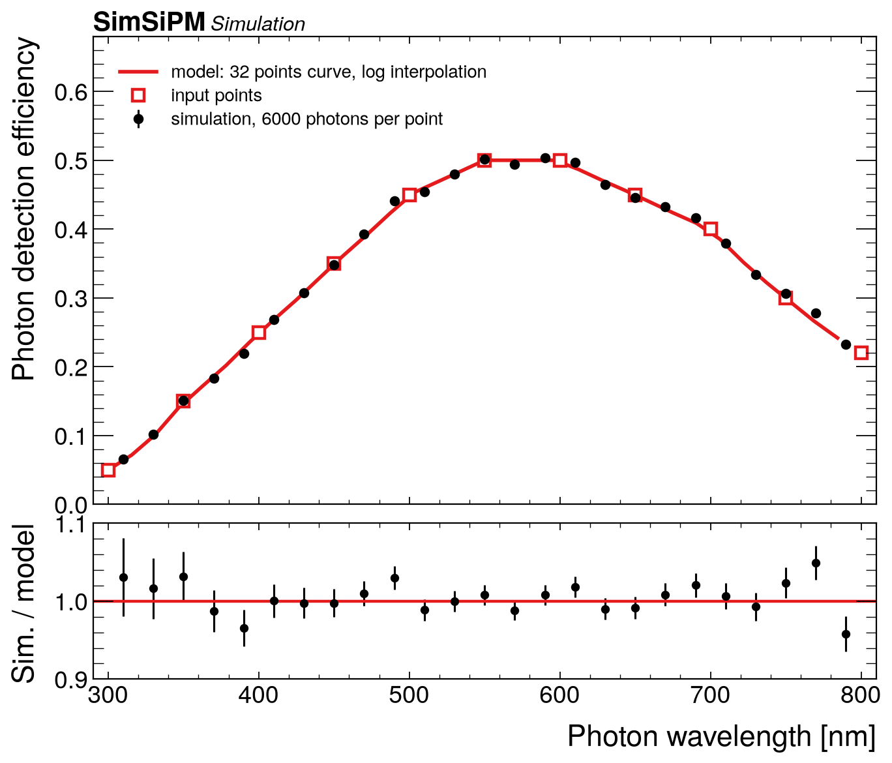</p>

The points given by the user are resampled on a uniform grid of 32 wavelengths between the first and the last one, interpolating in log space:

$$\ln \mathrm{PDE}(\lambda) = \frac{\ln y_0 \,\ln(x_1/\lambda) + \ln y_1 \,\ln(\lambda/x_0)}{\ln(x_1/x_0)}$$

where $(x_0, y_0)$ and $(x_1, y_1)$ are the two input points around $\lambda$. If one of the two points has a zero PDE the result in that interval is zero. During the simulation the PDE of each photon is linearly interpolated between the points of the resampled curve.

### Hit distribution
By default the photoelectrons are uniformly distributed on the surface of the SiPM. In most cases this assumption resembles what happens in a typical setup, but sometimes the geometry of the sensor or the optical characteristics of the setup lead to an inhomogeneous distribution of the light.

<p align="center">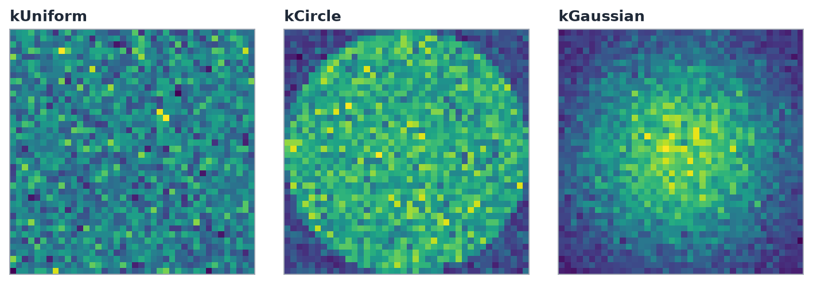</p>

- **`kUniform`** (default): each cell has the same probability to be hit.
- **`kCircle`**: 90 % of the photons are uniformly distributed inside the circle inscribed in the sensor, the remaining 10 % uniformly outside of it. It resembles the cases where the light is focused in the central region.
- **`kGaussian`**: photons follow a gaussian distribution centered on the sensor, with $\sigma$ equal to the side of the sensor divided by 3.28. The few photons that would fall further than 1.64 $\sigma$ from the center on one of the axes are distributed uniformly.

<!-- cpp -->
```cpp
props.setHitDistribution(SiPMProperties::HitDistribution::kGaussian);
sensor.setProperties(props);
```

### Noise
The sensor noise is described by a few parameters that can be measured in the laboratory. The figure shows the typical way to see them: for every pulse of a simulated dark-noise run without any light, the time since the previous pulse and the amplitude.

<p align="center">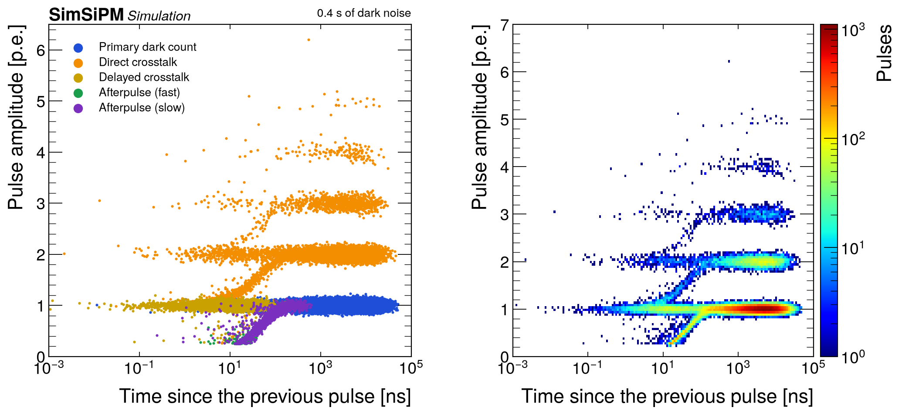</p>

- **Primary dark counts** are at 1 p.e. with long delays (the average delay is `1 / DCR` over the whole sensor).
- **Direct crosstalk** adds up to the pulse of its parent (2, 3, 4 p.e.), with the same time.
- **Delayed crosstalk** appears at 1 p.e. a few ns after its parent.
- **Afterpulses** have short delays and a reduced amplitude, which grows with the delay following the recovery of the cell (the curve ending in 1 p.e.).

Crosstalk and afterpulses use `Xt` and `Ap` as the average number of secondary hits generated by one hit (Poisson), so they can also produce chains of hits.

## Results
### Photoelectron spectrum
With a pulsed light source the integral of the signal shows the characteristic peaks of the SiPM: each peak is a different number of fired cells. The width of the peaks comes from the electronic noise and from the cell-to-cell gain variation, and the events between the peaks from dark counts, crosstalk and afterpulses.

<p align="center">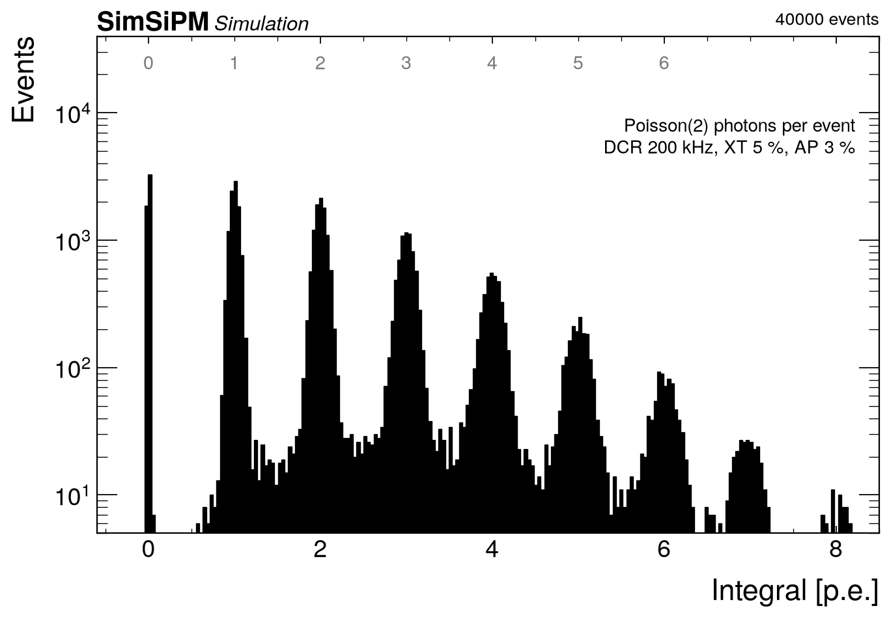</p>

### Saturation
A SiPM has a finite number of cells and a cell that has just fired cannot fire again at full amplitude: the response is linear for few photons and saturates when the number of photons approaches the number of cells. Smaller cells mean more cells, hence a larger dynamic range. The figures show the response to a burst of simultaneous photons (all detected), measured both with the integral and with the peak of the signal, for three cell sizes (10 events per point). The red curves are the simple model $N_{cells}(1-e^{-N/N_{cells}})$ of the number of fired cells.

With the dark counts, crosstalk and afterpulses switched off the simulation follows the model, with both the integral and the peak:

<p align="center">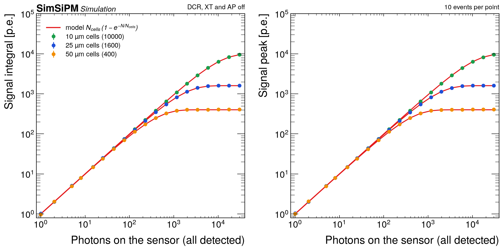</p>

With the default noise the peak still follows the model, but the integral of the sensor with the largest cells (only 400) keeps growing slowly above it: the noise hits that arrive after the light pulse add charge to the integral, while they cannot increase the peak measured at the time of the light.

<p align="center">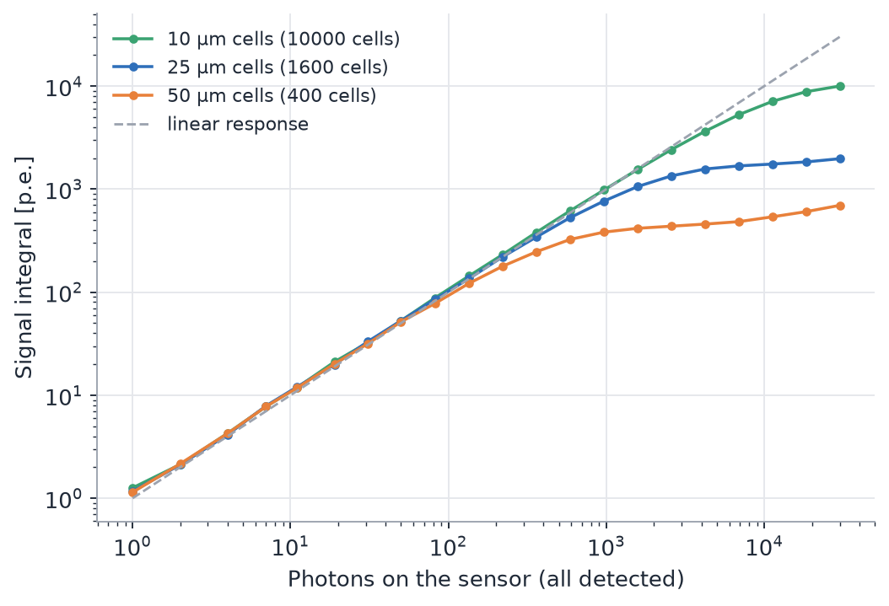</p>

## Performance
SimSiPM is designed to simulate millions of events. The numbers below are the **time to simulate one complete event** (reset, input of the photons, `runEvent`) on a default sensor (1 mm, 25 µm cells, 500 ns window, DCR 200 kHz, XT 5 %, AP 3 %), with photon times following a scintillation-like exponential decay. Full means `runEvent()` (hits and signal), hits only means `runEvent(false)`.

### Time versus number of photons
<p align="center">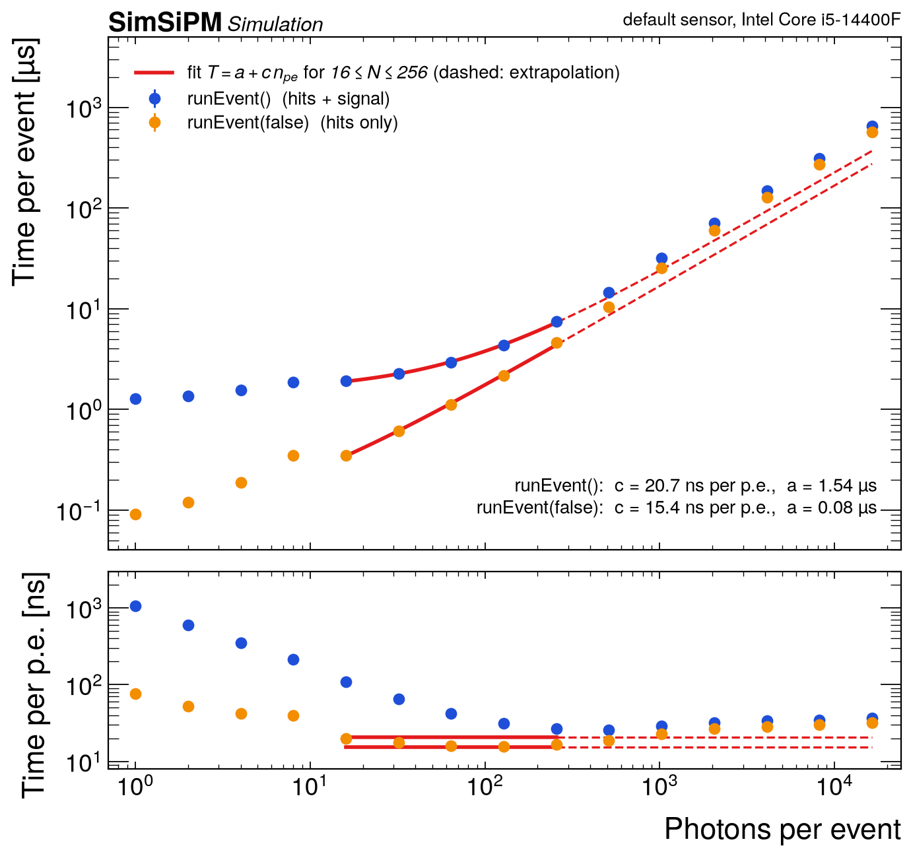</p>

The plot shows the time of one event for 1 to 16384 photons (powers of two, mean and standard deviation of 25 repetitions), and below it the time per hit cell ("p.e.": photoelectrons plus the crosstalk, afterpulse and dark-count hits they generate, about 1.09 per photon here). Up to a few hundred photoelectrons the time is linear in the number of hit cells, $T = a + c\,n_{pe}$ (red line, fitted on 16 to 256 photons):

| | `runEvent()` | `runEvent(false)` |
|---|---|---|
| Time per hit cell $c$ | 20.8 ns | 15.2 ns |
| Fixed cost per event $a$ | 1.63 µs | ≈ 0 |

The fixed cost is the electronic noise of the waveform, which is not generated when the signal is skipped. Above a few hundred photoelectrons the cost per hit cell grows slowly (the dashed extrapolation of the fit falls below the points): at 1000 photons it is 29 ns with the signal and 23 ns without, and at 16384 photons 38 ns and 33 ns. The pulses of the hits are summed with a recursive convolution, whose cost grows very slowly with the number of hits.

### Typical events
| Event | `runEvent()` | `runEvent(false)` | `runEvent()`, `-march=native` | `runEvent(false)`, `-march=native` |
|---|---|---|---|---|
| Empty event | 1.13 µs | 0.07 µs (17.3× faster) | 0.57 µs | 0.06 µs |
| 25 photons | 2.21 µs | 0.50 µs (4.4× faster) | 1.37 µs | 0.47 µs |
| 1000 photons | 31.1 µs | 24.5 µs (1.3× faster) | 28.9 µs | 22.2 µs |

Median of 25 repetitions, Intel Core i5-14400F, Linux (WSL2), clang, `-O3 -ffast-math`; the last two columns also use `-march=native` (AVX2 + FMA), which mostly helps small events because the generation of the electronic noise is vectorized. The relative spread of the repetitions is below 7 %. Skipping the signal makes an empty event 17 times faster and a 25-photon event 4.4 times faster.

### Impact of the PDE
A PDE removes the photons that are not detected, so they do not produce hits, crosstalk, afterpulses and pulses, and the event is faster. This is partly an illusion: there are simply fewer hits to process. The fair comparison is the time per hit cell (lower row of the figure and the table), and it goes **up** with a PDE: every input photon pays for the selection (a random number, plus an interpolation in the table of the spectrum for the spectral PDE) while only the detected ones become hits. With 1000 photons and the signal the cost per hit cell is 29 ns without PDE, 41 ns with the flat PDE and 57 ns with the spectral one. Taking the hits at the cost per hit cell of the no-PDE case, the selection itself costs about 4 ns per input photon with the flat PDE and 12 ns with the spectral PDE (an estimate from the 1000-photon hits-only events). For 25 photons the fixed costs of the event dominate, so the time per hit cell is large in all cases and the PDE costs a few tenths of a microsecond more. The table compares the same input photons (wavelengths between 400 and 600 nm); the spectral PDE averages 42 % on this range, like the flat one.

<p align="center">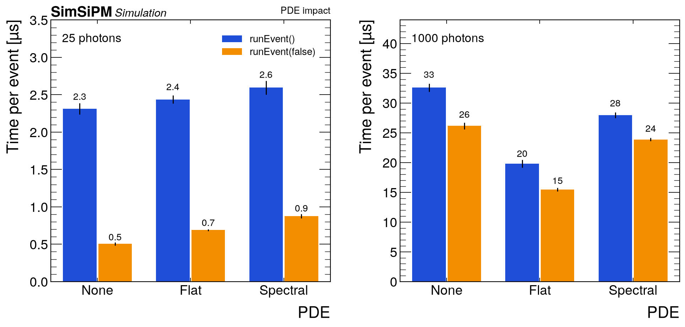</p>

| Photons | PDE | Hit cells (measured) | `runEvent()` | per hit cell | `runEvent(false)` | per hit cell |
|---|---|---|---|---|---|---|
| 25 | none | 27 | 2.26 µs | 83 ns | 0.50 µs | 18 ns |
| 25 | flat, 42 % | 12 | 2.32 µs | 202 ns | 0.66 µs | 57 ns |
| 25 | spectral, 42 % on average | 11 | 2.47 µs | 215 ns | 0.80 µs | 70 ns |
| 1000 | none | 1087 | 31.6 µs | 29 ns | 24.4 µs | 22 ns |
| 1000 | flat, 42 % | 457 | 18.6 µs | 41 ns | 14.7 µs | 32 ns |
| 1000 | spectral, 42 % on average | 454 | 25.8 µs | 57 ns | 22.3 µs | 49 ns |

The total time of a large event is still lower with a PDE because the detected hits are what costs most. Even so, the fastest option for the whole simulation is to apply the PDE before the photons are generated and tracked (`kNoPde` with only the detected photons): the rejected photons then cost nothing, not even the selection, and the tracking time is saved too.

To reproduce the numbers on your machine:
```sh
cmake -B build -S . -DSIPM_ENABLE_BENCH=ON
cmake --build build -j
./build/bench/events --benchmark_repetitions=25 --benchmark_report_aggregates_only=true
```
`bench/sensor` and `bench/random` have many more benchmarks (every phase of the event, geometry, signal length, random number generators). Instruction level profiling is described at the top of `bench/sensor.cpp`.

## Examples, tests and documentation
- [`examples/`](examples): Python scripts that use SimSiPM, among them the delay versus amplitude plot of the dark noise (`delays.py`), the signal of different sensors (`signals.py`), saturation (`saturation.py`), the staircase of the dark count rate (`staircase.py`) and a visual explanation of the recursive signal generation (`recursive_convolution.py`).
- [`examples/gui`](examples/gui): an interactive real-time simulator (sources, scintillators, SiPM models, oscilloscope and histograms). Build it with `-DSIPM_BUILD_GUI=ON`.
- **Tests**: configure with `-DSIPM_ENABLE_TEST=ON` and run `ctest --test-dir build`, or run the executables in `build/tests` directly. The Python tests run with `pytest tests` (with the module in `PYTHONPATH`).
- **Documentation**: configure with `-DSIPM_BUILD_DOCS=ON` (needs Doxygen) to generate the HTML documentation of all the classes in `build/docs/html`.
- **Figures**: the images of this page are generated by `docs/make_figures.py` with the Python module.

## Contributing
Feel free to contact me if you have any problem while including SimSiPM in your project, if you find a bug or have any suggestion or improvement. I would be pleased to discuss it with you.

## Cite
Even though SimSiPM has been used in simulations related to published articles, there is not yet an article about SimSiPM itself. So if you need to cite SimSiPM please use:
```
@manual{,
title = {{SimSiPM: a library for SiPM simulation}},
author = {Proserpio, Edoardo, and Santoro, Romualdo},
address = {Como, Italy},
year = 2021,
url = {https://github.com/EdoPro98/SimSiPM}
}
```

## Contacts
Author: Edoardo Proserpio
Email: edoardo.proserpio@gmail.com (private)
Email: eproserpio@studenti.uninsubria.it (institutional)

SimSiPM is released under the [MIT license](LICENSE).
